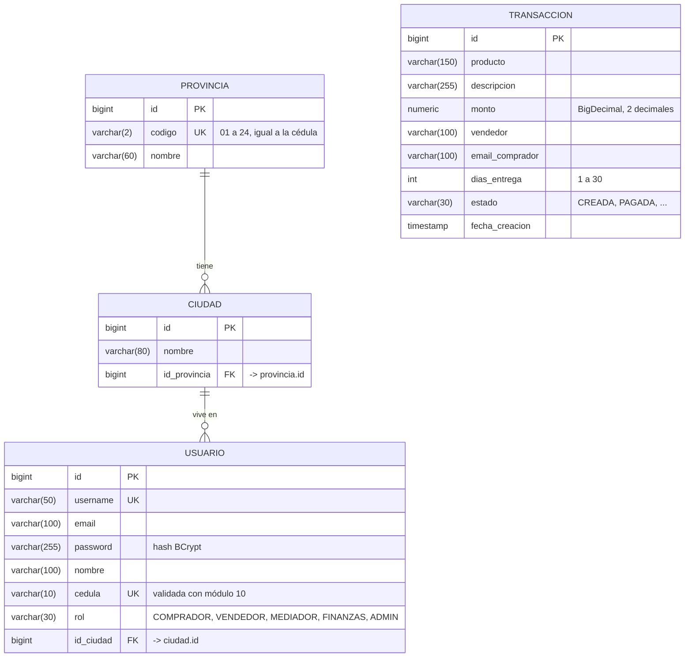

# Base de datos de TratoSeguro EC

En el servidor (Render) la base es **PostgreSQL 18** (`tratoseguro-db`). En local se usa H2 con las mismas tablas.
Las tablas no se escriben a mano: **JPA/Hibernate las crea a partir de las entidades Java** (`ddl-auto=update`).

## Diagrama entidad-relación

## Claves foráneas

| Tabla | Columna | Apunta a | Qué significa | En Java |
|---|---|---|---|---|
| `ciudad` | `id_provincia` | `provincia.id` | Cada ciudad pertenece a una provincia (1 provincia → N ciudades) | `@ManyToOne` + `@JoinColumn(name = "id_provincia")` en `Ciudad` |
| `usuario` | `id_ciudad` | `ciudad.id` | Cada usuario vive en una ciudad (1 ciudad → N usuarios) | `@ManyToOne` + `@JoinColumn(name = "id_ciudad")` en `Usuario` |

Hibernate les pone un nombre automático a las restricciones (por ejemplo `fkkedh5so3ts9ll01l1mlp796ea`); lo que
importa es la columna y la tabla a la que apuntan.

**La base también protege las relaciones**, no solo la aplicación:

- Insertar un usuario con `id_ciudad = 99999` da *ERROR: violates foreign key constraint*.
- Borrar una provincia que tiene ciudades da *ERROR: ... is still referenced from table "ciudad"*.

## Cómo se guarda cada dato

| Dato | Cómo se guarda | Por qué |
|---|---|---|
| Ids | `bigint` autonumérico (`generated by default as identity`) | `@GeneratedValue(strategy = IDENTITY)` |
| Contraseña | Hash **BCrypt** (`$2a$10$...`), nunca el texto original | `passwordEncoder.encode(...)` en `UsuarioService` |
| Cédula | Texto de 10 caracteres, **única** | Se valida con módulo 10 en el servidor antes de guardar |
| Usuario (username) | Texto, **único** | No pueden existir dos cuentas iguales |
| Rol / estado | Texto con una restricción `CHECK` que solo acepta los valores del enum | `@Enumerated(EnumType.STRING)` |
| Ciudad del usuario | Solo el **número** de la ciudad (`id_ciudad`), no su nombre | Normalización: el nombre se obtiene con un `JOIN` |
| Monto | `numeric` con 2 decimales | `BigDecimal` en Java; nunca `double` para dinero |

## Consultas para revisar la base

Las consultas listas para DBeaver están en [`consultas.sql`](consultas.sql): tablas, claves foráneas, cómo se
guarda un usuario, el `JOIN` usuario → ciudad → provincia, ciudades por provincia y dos pruebas que la base
rechaza (ciudad inexistente y borrar una provincia con ciudades).
