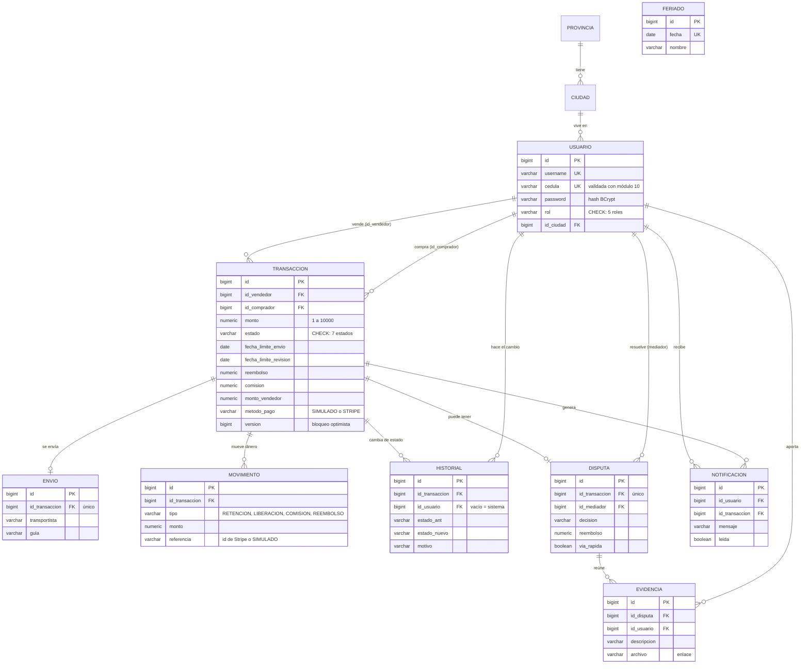

# Base de datos de TratoSeguro EC

En el servidor (Render) la base es **PostgreSQL 18** (`tratoseguro-db`); en local y en las pruebas se usa H2 con
el mismo esquema. Las tablas las crea **Flyway** con el script `src/main/resources/db/migration/V1__esquema_core.sql`;
Hibernate solo valida que las entidades Java coincidan (`ddl-auto=validate`).

## Diagrama entidad-relación

## Claves foráneas

| Restricción | Tabla.columna | Apunta a | Significado |
|---|---|---|---|
| `fk_ciudad_provincia` | `ciudad.id_provincia` | `provincia.id` | Cada ciudad pertenece a una provincia |
| `fk_usuario_ciudad` | `usuario.id_ciudad` | `ciudad.id` | Ciudad donde vive el usuario |
| `fk_transaccion_vendedor` | `transaccion.id_vendedor` | `usuario.id` | Quién vende |
| `fk_transaccion_comprador` | `transaccion.id_comprador` | `usuario.id` | Quién compra |
| `fk_envio_transaccion` | `envio.id_transaccion` (único) | `transaccion.id` | Un trato tiene 0 o 1 envío |
| `fk_movimiento_transaccion` | `movimiento.id_transaccion` | `transaccion.id` | Movimientos de dinero del trato |
| `fk_historial_transaccion` | `historial.id_transaccion` | `transaccion.id` | Expediente del trato |
| `fk_historial_usuario` | `historial.id_usuario` | `usuario.id` | Quién hizo el cambio (vacío = sistema) |
| `fk_disputa_transaccion` | `disputa.id_transaccion` (único) | `transaccion.id` | Un trato tiene 0 o 1 disputa |
| `fk_disputa_mediador` | `disputa.id_mediador` | `usuario.id` | Mediador que la resolvió |
| `fk_evidencia_disputa` | `evidencia.id_disputa` | `disputa.id` | Evidencias de la disputa |
| `fk_evidencia_usuario` | `evidencia.id_usuario` | `usuario.id` | Quién aportó la evidencia |
| `fk_notificacion_usuario` | `notificacion.id_usuario` | `usuario.id` | Destinatario |
| `fk_notificacion_transaccion` | `notificacion.id_transaccion` | `transaccion.id` | Trato que la generó |

## Restricciones de la propia base (última barrera)

| Restricción | Qué impide |
|---|---|
| `ck_transaccion_estado` | Un estado que no sea uno de los 7 del core |
| `ck_transaccion_monto` | Montos fuera de $ 1 a $ 10.000 |
| `ck_transaccion_dias` | Días de entrega fuera de 1 a 30 |
| `ck_transaccion_partes` | Que el vendedor y el comprador sean la misma persona |
| `ck_movimiento_tipo`, `ck_movimiento_monto` | Tipos desconocidos o montos negativos |
| `ck_usuario_rol` | Un rol que no exista |
| `uk_usuario_cedula`, `uk_usuario_username` | Cédulas o usuarios repetidos |
| `uk_envio_transaccion`, `uk_disputa_transaccion` | Dos envíos o dos disputas para el mismo trato |

## Cómo se guarda cada dato

| Dato | Cómo se guarda | Por qué |
|---|---|---|
| Contraseña | Hash **BCrypt** (`$2a$10$...`) | Nunca se guarda el texto original |
| Vendedor y comprador | Solo el **id** del usuario | Normalización: el nombre se obtiene con un `JOIN` |
| Dinero | `NUMERIC(10,2)` ↔ `BigDecimal` | Nunca `double` para dinero |
| Estado, rol, tipo | Texto con `CHECK` | Legible en la base y validado por ella |
| Plazos | `DATE` | Se calculan en días hábiles en el servidor |
| Versión | `BIGINT` | `@Version`: evita liquidar el mismo dinero dos veces |

Consultas listas para DBeaver: [`consultas.sql`](consultas.sql).
